|  | Pemrograman Berbasis Objek |
|--|--|
| NIM |  254107020062|
| Nama | Aura Bintang Aprilian |
| Kelas | TI - 2G |
| Repository | [link] (https://github.com/bebeaura1/PBO/tree/main/Jobsheet7) |

# Overloading dan Overriding

## - Percobaan 1:  Overloading Method (Perkalian)
Untuk hasil running program pada percobaan 1 pada beberapa langkah yaitu seperti dibawah ini.<br>
- Langkah 3 :<br>
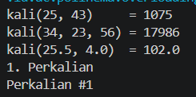<br>
- Langkah 5 :<br>
    - Eror 1<br>
    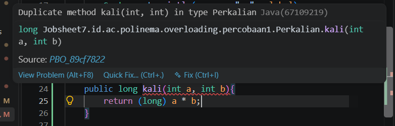<br>
    - Eror 2<br>
    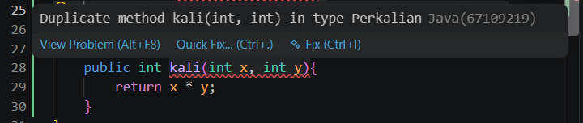<br>
    - Hasil<br>
    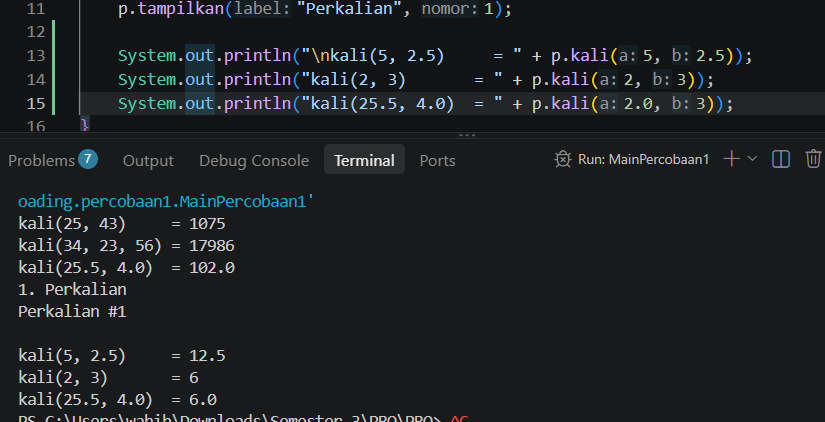<br><br>
        ```
        +----------------------------------------------------------------+
        | Tambahan pada class Perkalian       | Hasil                    |
        |-------------------------------------|--------------------------|
        | public long kali(int a, int b){     | Pesan error : Duplicate  |
        |       return (long) a * b;          | method kali(int, int)    |
        | }                                   | in type Perkalian        |
        |-------------------------------------|--------------------------|
        | public int kali(int x, int y){      | Pesan error : Duplicate  |
        |       return x * y;                 | method kali(int, int)    |
        | }                                   | in type Perkalian        |
        |-------------------------------------|--------------------------|
        | Pada MainPercobaan1:                | Output : 12.5, 6, 6.0    |
        | p.kali(5, 2.5), p.kali(2, 3),       |                          |
        |  p.kali(2.0, 3)                     |                          |
        +----------------------------------------------------------------+
        ```

**Jawaban Pertanyaan Percobaan 1** <br>
1. - Method kali(...) di overload menjadi tiga versi dengan pembeda pada jumlah dan tipe parameter : kali(int, int), kali(int, int, int), dan kali(double, double).
    - Method tampilkan(...) di overload menjadi dua versi dengan pembeda pada urutan tipe parameter : tampilkan(int, String) dan tampilkan(String, int).
2. Versi yang dipanggil adalah kali(double, double). Alasannya karena argumen yang dikirimkan berupa angka desimal (double), sehingga compiler mencocokkan parameter yang tipe datanya sama persis<br>
3. Karena compiler membedakan method berdasarkan jumlah, tipe, dan urutan parameter. Nama variabel parameter dan tipe kembalian tidak ikut dicatat oleh compiler saat melakukan resolusi pemanggilan method.<br>
4. Karena terjadi proses pelebaran tipe data otomatis. Nilai 5 yang bertipe int diperlebar secara otomatis oleh compiler menjadi double agar cocok dengan method kali(double, double)<br>

## - Percobaan 2:  Overloading Method (Perkalian)
Untuk hasil running program pada percobaan 2 pada beberapa langkah yaitu seperti dibawah ini.<br>
- Langkah 2 :<br>
    - Perkiraan
        ```
        +----------------------------------------+
        | Pemanggilan                | Hasil     |
        |----------------------------|-----------|
        | tampil(5)                  | 5         |
        | tampil(5L)                 | 5         |
        | tampil(Integer.valueOf(7)) | 7         |
        | tampil(3.5)                | 3.5       |
        | tampil("Java")             | Java      |
        | tampil()                   | 0         |
        | tampil(1, 2, 3)            | 3         |
        +----------------------------------------+
        ```
    - Hasil<br>
    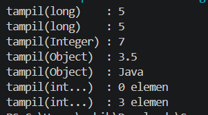<br>
- Langkah 3 :<br>
    ```
        +----------------------------------------------+
        | Kondisi                          | Hasil     |
        |----------------------------------|-----------|
        | Semua overload aktif             | 5         |
        |----------------------------------|-----------|
        | tampil(long) dikomentari         | 5         |
        |----------------------------------|-----------|
        | tampil(long) dan tampil(Integer) | 7         |
        | dikomentari                      |           |
        |----------------------------------|-----------|
        | tampil(long), tampil(Integer),   | 3.5       |
        | dan tampil(Object) dikomentari   |           |
        +----------------------------------------------+
         ```
- Hasil Langkah 3<br>
    - Semua overload aktif :  
    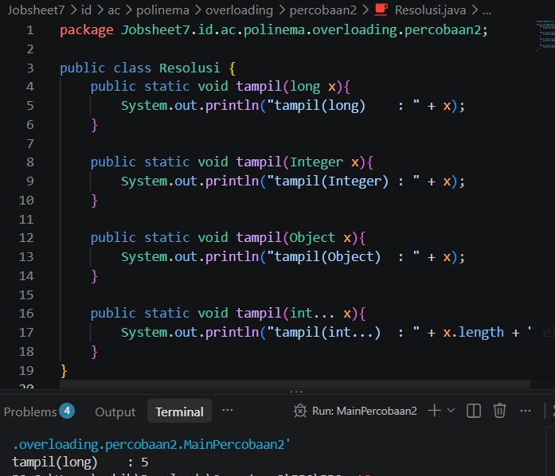<br>
    - tampil(long) dikomentari :  
    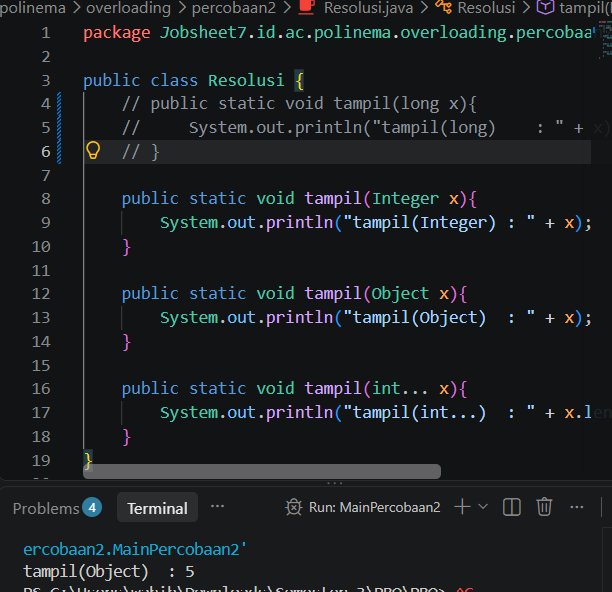<br>
    - tampil(long) dan tampil(Integer) dikomentari  :  
    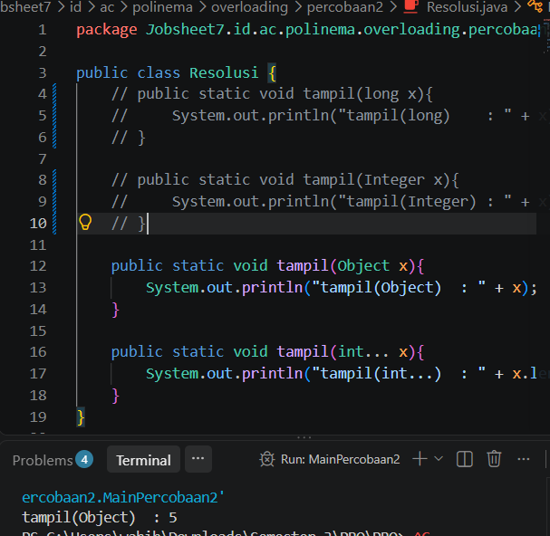<br>
    - tampil(long), tampil(Integer), dan tampil(Object) dikomentari :  
    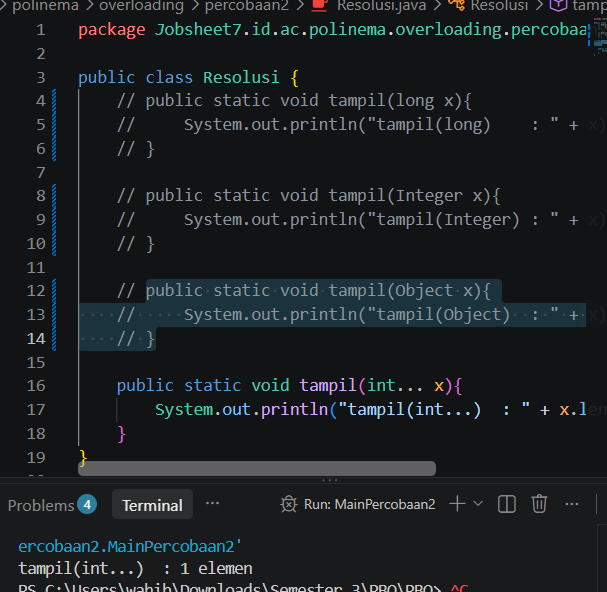<br>
- Langkah 4 :<br>
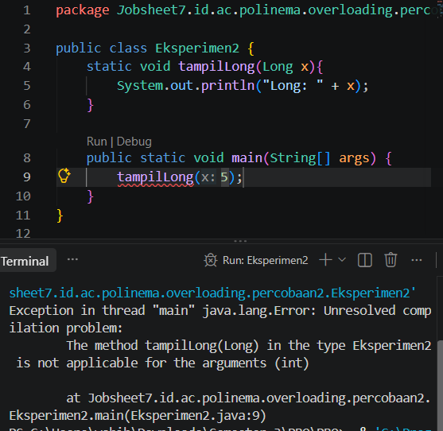<br><br>

**Jawaban Pertanyaan Percobaan 2** <br>
1. tampil(5) memilih tampil(long) karena compiler mengeksekusi Fase 1 terlebih dahulu, yaitu pencocokan eksak dan widening (dari int ke long). Proses boxing (int ke Integer) baru akan dicek pada fase berikutnya jika Fase 1 tidak ada yang cocok<br>
2. Ketika tampil(long) dikomentari, tampil(5) pindah memanggil tampil(Integer) melalui proses boxing. Ketika tampil(Integer) juga dikomentari, ia beralih ke tampil(Object) melalui boxing lalu widening ke Object. Jika ketiganya itu dikomentar, ia akan lari ke tampil(int...)<br>
3. Java tidak mengizinkan kombinasi widening dilanjutkan boxing (dari int ke long lalu ke Long). Sebaliknya, Java mengizinkan boxing dilanjutkan widening dari int ke Integer lalu ke Object<br>
4. Output dari Resolusi.tampil((short) 3) adalah 3 dan Resolusi.tampil('A') adalah angka int yang di widening dari int ke long<br>
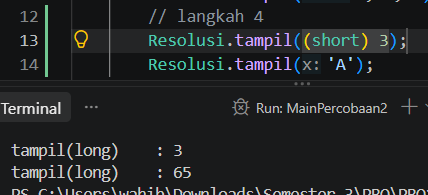<br><br>

## - Percobaan 3:  Overloading Konstruktor (Kucing)
Untuk hasil running program pada percobaan 3 pada beberapa langkah yaitu seperti dibawah ini.<br>
- Langkah 3 :<br>
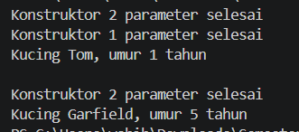<br>
- Langkah 4 :<br>
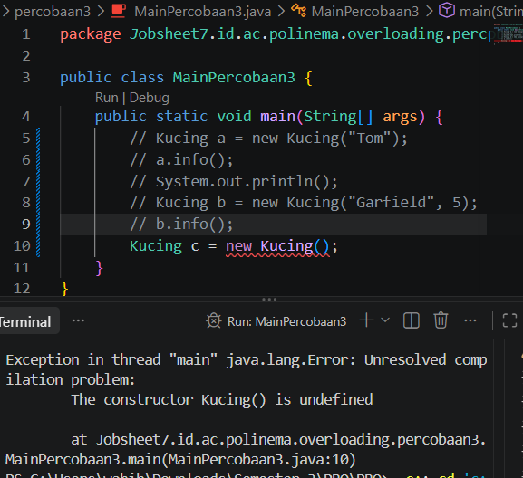<br>
Pesan error : Exception in thread "main" java.lang.Error: Unresolved compilation problem: 
    The constructor Kucing() is undefined
at Jobsheet7.id.ac.polinema.overloading.percobaan3.MainPercobaan3.main(MainPercobaan3.java:10)<br><br>

**Jawaban Pertanyaan Percobaan 3** <br>
1. Karena konstruktor 1 parameter memanggil this(nama, 1) di baris pertamanya, sehingga aliran program mengeksekusi konstruktor 2 parameter terlebih dahulu sampai selesai, baru kemudian kembali menyelesaikan sisa baris di konstruktor 1 parameter.<br>
2. Menghindari duplikasi kode, sehingga pemeliharaan kode jauh lebih mudah jika ada perubahan logika inisialisasi di masa mendatang<br>
3. Urutan cetak saat new Kucing() dipanggil adalah konstruktor 2 parameter selesai, lalu Konstruktor 1 parameter selesai, dan terakhir Konstruktor 0 parameter selesai.<br><br>

## - Percobaan 4: Dasar Overriding (Ikan dan Piranha)
Untuk hasil running program pada percobaan 4 pada beberapa langkah yaitu seperti dibawah ini.<br>
- Langkah 3 :<br>
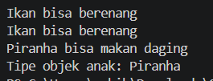<br>
- Langkah 4 :<br>
    ```
        +--------------------------------------------------------------------------+
        | Perubahan               | Pesan error pertama                            |
        |-------------------------|------------------------------------------------|
        | Hapus public pada       | Exception in thread "main" java.lang.Error:    |
        | swim() di Piranha       | Unresolved compilation problem:                |
        |                         | Cannot reduce the visibility of the            |
        |                         | inherited method from Ikan                     |
        |-------------------------|------------------------------------------------|
        | Tambahkan final pada    | Exception in thread "main" java.lang.          |
        | swim() di Ikan (public  | IncompatibleClassChangeError: class Jobsheet7. |
        | final void swim())      | id.ac.polinema.overloading.percobaan4.Piranha  |
        |                         | overrides final method Jobsheet7.id.ac.polinema|
        |                         | .overloading.percobaan4.Ikan.swim()V           |
        |-------------------------|------------------------------------------------|
        | Ubah swim() di Piranha  | The method swim(int) of type Piranha must      |
        | menjadi swim(int jarak),| override or implement a supertype method       |
        | @Override tetap ada     |                                                |
        |-------------------------|------------------------------------------------|
        | Tambahkan throws        | Exception Exception is not compatible with     |
        | Exception pada swim()   | throws clause in Ikan.swim()                   |
        | di Piranha              |                                                |
        +--------------------------------------------------------------------------+
         ```

- Hasil Langkah 4 : <br>
    - Hapus public pada swim() di Piranha :  
    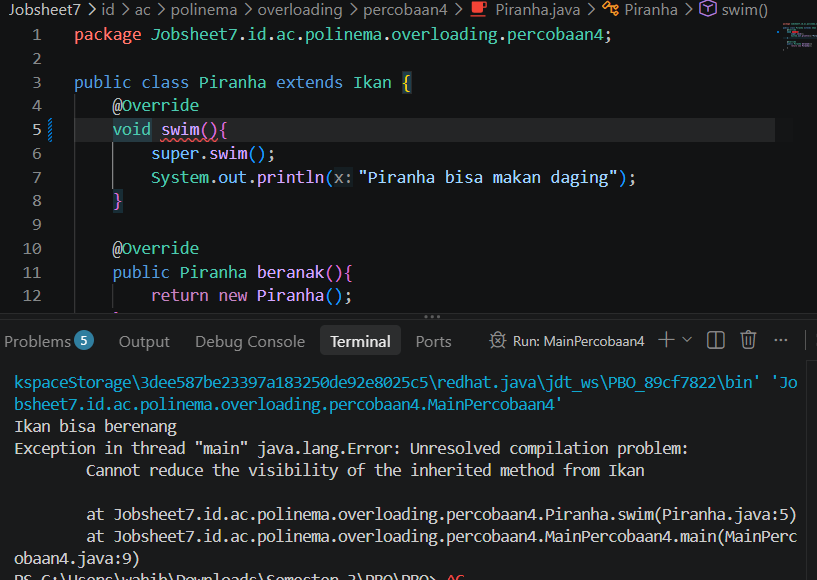<br>
    - Tambahkan final pada swim() di Ikan (public final void swim()) :  
    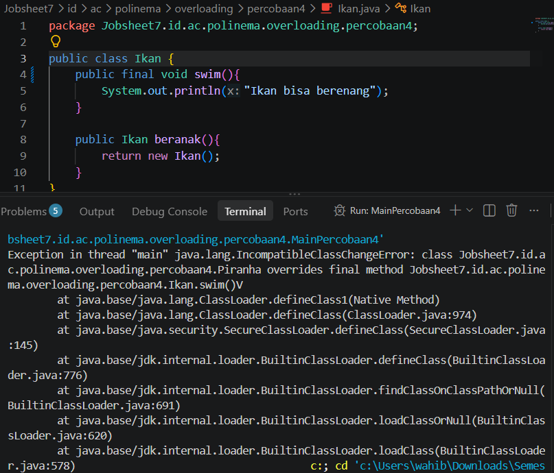<br>
    - Ubah swim() di Piranha menjadi swim(int jarak), @Override tetap ada :  
    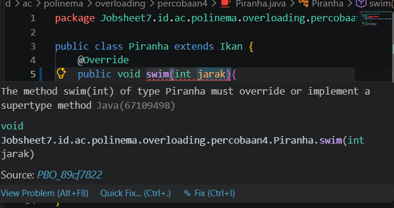<br>
    - Tambahkan throws Exception pada swim() di Piranha :  
    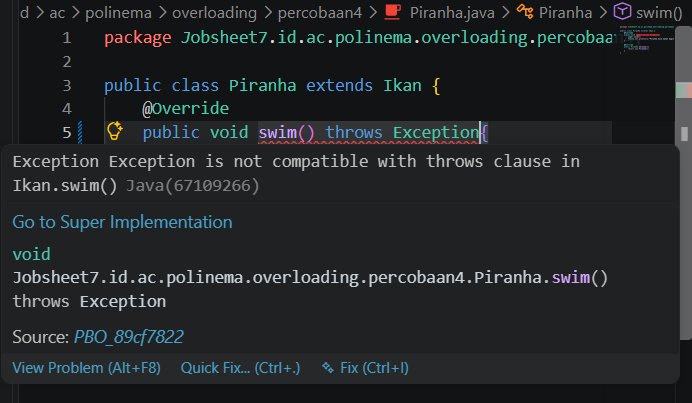<br>

**Jawaban Pertanyaan Percobaan 4** <br>
1. super.swim() berfungsi untuk memanggil method swim() milik class induk (Ikan) dari dalam class anak (Piranha). Jika baris itu dihapus, teks "Ikan bisa berenang" tidak akan dicetak, dan hanya memunculkan "Piranha bisa makan daging"<br>
2. Covariant return memungkinkan method overriding mengembalikan tipe data objek yang merupakan subclass dari tipe kembalian aslinya. Pemanggilan Piranha anak = c.beranak(); valid karena method beranak() pada Piranha mengembalikan objek bertipe Piranha sendiri, sehingga variabel penampungnya tidak perlu melakukan casting manual<br>
3. - Hapus public di Piranha : Melanggar aturan hak akses tidak boleh lebih sempit dari superclass<br>
    - Tambahkan final di Ikan : Melanggar aturan bahwa method yang bersifat final tidak boleh di-override<br>
    - Ubah parameter swim(int jarak) dengan @Override : Melanggar karena method tersebut tidak cocok dengan signature induknya<br>
    - Tambahkan throws Exception: Melanggar aturan karena method overriding tidak boleh melempar checked exception baru yang tidak dideklarasikan oleh method aslinya<br>
4. Jika @Override dihapus, kode akan lolos kompilasi tanpa error. Jika @Override dihapus, kode akan lolos kompilasi tanpa error<br>
5. Terjadi error kompilasi karena method private di class induk sifatnya tersembunyi dan tidak bisa diwarisi, sehingga Piranha tidak dianggap melakukan override melainkan membuat method baru<br>
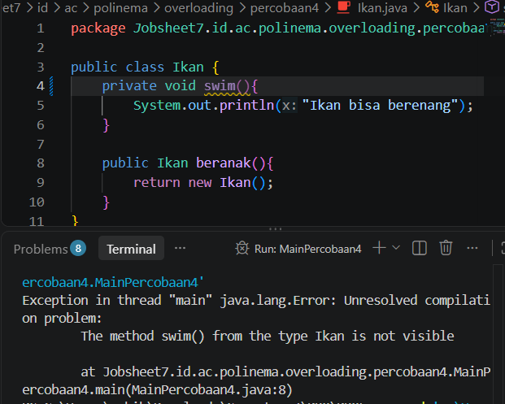<br><br>

## - Percobaan 5: Overloading dan Overriding Bersama (Karyawan, Staff, Manager)
Untuk hasil running program pada percobaan 5 yaitu seperti dibawah ini.<br>
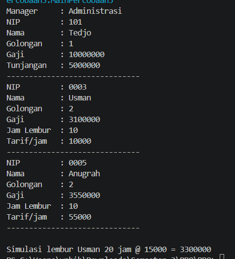<br>

**Jawaban Pertanyaan Percobaan 5** <br>
1. - Overloading terdapat pada class Staff dengan signature getGaji(int jamLembur, double tarifLembur) dan getGaji(). Pembedanya adalah jumlah dan tipe parameter yang diterima.
    - Overriding :
        - Terdapat pada class Staff dengan signature getGaji() dan lihatInfo()
        - Terdapat pada class Manager dengan signature getGaji() dan lihatInfo()
        - Pembedanya adalah signature kedua method tersebut sama persis dengan method milik superclass-nya (Karyawan)
2. getGaji(int, double) memakai super.getGaji() untuk mengambil gaji pokok dasar langsung dari class induk (Karyawan), sedangkan getGaji() pada Staff memanggil versi overload nya (getGaji(jamLembur, tarifLembur)) agar perhitungan gaji pokok otomatis digabungkan dengan lembur.<br>
Jika isi getGaji(int, double) diganti menjadi return getGaji() + jamLembur * tarifLembur;, program akan mengalami rekursif tanpa henti karena method tersebut akan memanggil dirinya sendiri secara terus menerus<br>
3. Akibatnya, gaji total Staff hanya akan dihitung dari uang lemburnya saja tanpa menjumlahkan gaji pokok dari class Karyawan. Gaji Manager tidak ikut berubah karena Manager memiliki implementasi method getGaji() sendiri yang memanggil super.getGaji() + tunjangan secara terpisah.<br>
4. Hubungan Manager dengan Staff adalah has-a (agregasi) yang ditunjukkan melalui atribut array private Staff[] bawahan; di dalam class Manager.<br>
Hubungan tersebut berbeda dengan hubungan Manager dengan Karyawan yang merupakan is-a (pewarisan / inheritance), di mana Manager mewarisi sifat dan atribut dari class Karyawan (public class Manager extends Karyawan).<br>