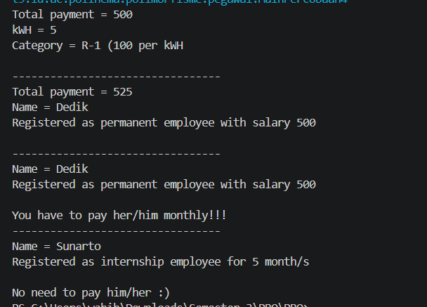
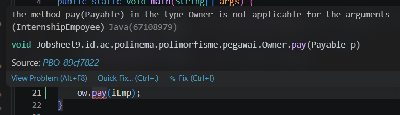
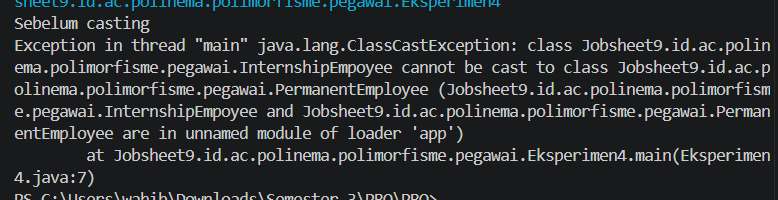

|  | Pemrograman Berbasis Objek |
|--|--|
| NIM |  254107020062|
| Nama | Aura Bintang Aprilian |
| Kelas | TI - 2G |
| Repository | [link] (https://github.com/bebeaura1/PBO/tree/main/Jobsheet9) |

# Polimorfisme

## - Percobaan 1: Bentuk Dasar Polimorfisme
Untuk hasil running program pada percobaan 1 pada beberapa langkah yaitu seperti dibawah ini.<br>
- Langkah 3 :<br>
<br>
- Langkah 4 (error) :<br>
<br>
    ```
        +------------------------------------------------------------------------------------+
        | Perubahan                         | Pesan error                                    |
        |-----------------------------------|------------------------------------------------|
        | Aktifkan baris Vegetarian v2 = l; | Type mismatch: cannot convert from             |
        |                                   | GambaranDasar.Lion to GambaranDasar.Vegetarian |
        +------------------------------------------------------------------------------------+
    ```
- Langkah 9 :<br>
<br>

**Jawaban Pertanyaan Percobaan 1** <br>
1. Class InternshipEmployee dan PermanentEmployee<br>
2. Class PermanentEmployee dan ElectricityBill<br>
3. Karena e memiliki tipe referensi Employee, sedangkan PermanentEmployee dan InternshipEmployee merupakan subclass dari Employee<br>
4. Karena p memiliki tipe referensi interface Payable, sedangkan class PermanentEmployee dan ElectricityBill keduanya meng-implements interface Payable<br>
5. - p = iEmp; error karena InternshipEmployee tidak meng-implements interface Payable
    - e = eBill; error karena ElectricityBill bukan turunan dari class Employee<br>
Error ini sama persis dengan Vegetarian v2 = l; pada GambaranDasar, di mana Lion tidak meng-implements Vegetarian. Tipe data referensi tidak cocok dengan hierarki kelas dari objek yang ditunjuk<br>
6. - Tipe Referensi: Tipe data variabel saat deklarasi/kompilasi (Animal), yang menentukan method atau field apa saja yang boleh dipanggil oleh programmer.
    - Tipe Objek: Tipe data asli dari objek yang dibuat di memori heap saat runtime dengan new (Deer), yang menentukan versi eksekusi aktual dari method tersebut<br>
7. Polimorfisme memungkinkan sebuah variabel referensi bertipe superclass atau interface untuk menunjuk objek dari subclass atau class implementor-nya. Hal ini memungkinkan satu variabel memiliki banyak bentuk perilaku sesuai objek aslinya.<br><br>

## - Percobaan 2: Virtual Method Invocation
Untuk hasil running program pada percobaan 2 pada beberapa langkah yaitu seperti dibawah ini.<br>
- Langkah 2 :<br>
<br>
- Langkah 3 :<br>
<br>
- Langkah 4 :<br>
<br>
    ```
        +-----------------------------------------------------------------------+
        | Perubahan                     | Pesan error                           |
        |-------------------------------|---------------------------------------|
        | Panggil e.getSalary() pada e  | The method getSalary() is undefined   |
        | bertipe Employee              | for the type Employee                 |
        +-----------------------------------------------------------------------+
    ```

**Jawaban Pertanyaan Percobaan 2** <br>
1. Karena variabel e dan pEmp menunjuk ke objek yang sama di memori, yaitu objek PermanentEmployee (Dedik)<br>
2. Disebut pemanggilan method virtual pada e karena compiler mengenali method berdasarkan tipe referensi Employee, tetapi saat dijalankan, java secara dinamis memanggil versi overriding milik PermanentEmployee. Sedangkan pEmp sudah secara langsung bertipe PermanentEmployee dari awal sehingga tidak memerlukan resolusi tipe secara dinamis<br>
3. Virtual Method Invocation adalah mekanisme pemanggilan method hasil overriding melalui variabel referensi polimorfik. Disebut virtual karena method yang terlihat oleh compiler (berdasarkan tipe referensi) berbeda dengan versi method yang seandainya/sebenarnya dieksekusi oleh JVM saat program berjalan (berdasarkan tipe objek)<br>
4. Karena isi objek dari variabel e telah diubah dari PermanentEmployee menjadi InternshipEmployee. Versi method getEmployeeInfo() yang dijalankan selalu menyesuaikan tipe objek yang sedang ditunjuk oleh e<br>
5. Karena compiler melakukan pemeriksaan kelayakan syntax berdasarkan tipe referensi (Employee), bukan tipe objek. Class Employee tidak memiliki method getSalary(), sehingga compiler menganggap method tersebut tidak ada / cannot find symbol.<br><br>

## - Percobaan 3: Heterogeneous Collection
Untuk hasil running program pada percobaan 3 pada beberapa langkah yaitu seperti dibawah ini :<br>
- Langkah 2 :<br>
<br>
- Langkah 3 :<br>
<br>
    ```
        +-----------------------------------------------------------------------+
        | Perubahan                     | Pesan error                           |
        |-------------------------------|---------------------------------------|
        | Aktifkan baris Employee[] e2  | Type mismatch: cannot convert from    |
        | = {pEmp, iEmp, eBill};        | ElectricityBill to Employee           |
        +-----------------------------------------------------------------------+
    ```

**Jawaban Pertanyaan Percobaan 3** <br>
1. Karena tipe dari array e adalah Employee[] (superclass), sehingga mampu menampung semua objek yang merupakan turunan dari Employee<br>
2. Karena tipe dari array p adalah Payable[] (interface), sehingga mampu menampung semua objek dari class mana pun yang meng-implements interface Payable<br>
3. Karena eBill adalah objek dari class ElectricityBill yang bukan turunan dari Employee, sehingga tidak memenuhi syarat tipe data untuk dimasukkan ke dalam Employee[]<br>
4. Hal ini terjadi karena penerapan Virtual Method Invocation (VMI). Walaupun dipanggil lewat variabel penampung bertipe Employee, JVM mengeksekusi method getEmployeeInfo() sesuai versi milik objek asli dari masing-masing elemen array (elemen 1 mengeksekusi versi PermanentEmployee, elemen 2 mengeksekusi versi InternshipEmployee)<br><br>

## - Percobaan 4: Polymorphic Argument, instanceof, dan Casting Objek
Untuk hasil running program pada percobaan 4 pada beberapa langkah yaitu seperti dibawah ini :<br>
- Langkah 3 :<br>
<br>
- Langkah 4 :<br>
    - <br><br>
    - <br>
    ```
        +-----------------------------------------------------------------+
        | Perubahan               | Hasil                                 |
        |-------------------------|---------------------------------------|
        | Tambahkan ow.pay(iEmp); | The method pay(Payable) in the type   |
        | di akhir main pada      | Owner is not applicable for the       |
        | MainPercobaan4          | arguments (InternshipEmpoyee)         |
        |-------------------------|---------------------------------------|
        | Buat class Eksperimen4  | Type mismatch: cannot convert from    |
        | berikut dan jalankan    | ElectricityBill to Employee           |
        +-----------------------------------------------------------------+
    ```

**Jawaban Pertanyaan Percobaan 4** <br>
1. Karena baik ElectricityBill (eBill) maupun PermanentEmployee (pEmp) sama-sama meng-implements interface Payable<br>
2. Agar method pay() bersifat fleksibel dan gampang dikembangkan. Method ini dapat menerima objek apa saja dari class mana pun selama class tersebut meng-implements Payable, tanpa perlu membuat method overload terpisah untuk tiap jenis pembayaran<br>
3. Karena iEmp (InternshipEmployee) tidak meng-implements interface Payable, sehingga tidak memenuhi syarat parameter dari method pay(Payable p)<br>
4. Untuk mengecek secara aman (type checking) apakah objek yang ditunjuk oleh referensi p benar-benar merupakan instansiasi dari class ElectricityBill sebelum dilakukan downcasting, sehingga terhindar dari ClassCastException<br>
5. Casting (downcasting) diperlukan untuk mengubah tipe referensi variabel dari Payable menjadi ElectricityBill. Hal ini wajib dilakukan agar kita dapat memanggil method getBillInfo(), karena method tersebut hanya dimiliki oleh class ElectricityBill dan tidak ada di dalam interface Payable<br>
6. Kode lolos kompilasi karena compiler hanya melihat bahwa e bertipe Employee dan PermanentEmployee adalah subclass dari Employee, sehingga casting dianggap secara hirarki memungkinkan. Kode gagal saat dijalankan karena objek asli yang berada di memori adalah InternshipEmployee, yang tidak memiliki relasi kekeluargaan langsung dengan PermanentEmployee. instanceof mencegah hal ini dengan memvalidasi tipe objek aktual terlebih dahulu: if (e instanceof PermanentEmployee). Casting hanya dilakukan jika hasil evaluasinya bernilai true.<br><br>