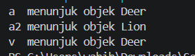
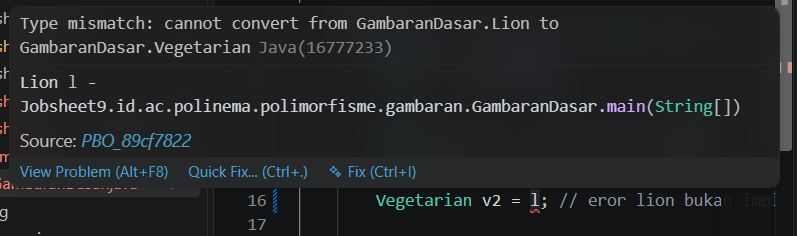
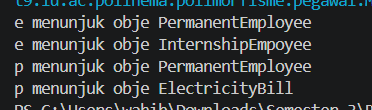
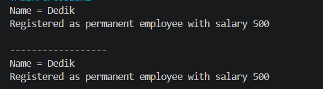
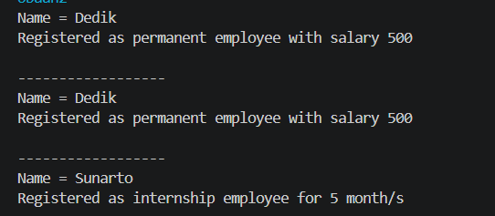

|  | Pemrograman Berbasis Objek |
|--|--|
| NIM |  254107020062|
| Nama | Aura Bintang Aprilian |
| Kelas | TI - 2G |
| Repository | [link] (https://github.com/bebeaura1/PBO/tree/main/Jobsheet9) |

# Polimorfisme

## - Percobaan 1: Bentuk Dasar Polimorfisme
Untuk hasil running program pada percobaan 1 pada beberapa langkah yaitu seperti dibawah ini.<br>
- Langkah 3 :<br>
<br>
- Langkah 4 (error) :<br>
<br>
    ```
        +------------------------------------------------------------------------------------+
        | Perubahan                         | Pesan error                                    |
        |-----------------------------------|------------------------------------------------|
        | Aktifkan baris Vegetarian v2 = l; | Type mismatch: cannot convert from             |
        |                                   | GambaranDasar.Lion to GambaranDasar.Vegetarian |
        +------------------------------------------------------------------------------------+
    ```
- Langkah 9 :<br>
<br>

**Jawaban Pertanyaan Percobaan 1** <br>
1. Class InternshipEmployee dan PermanentEmployee<br>
2. Class PermanentEmployee dan ElectricityBill<br>
3. Karena e memiliki tipe referensi Employee, sedangkan PermanentEmployee dan InternshipEmployee merupakan subclass dari Employee<br>
4. Karena p memiliki tipe referensi interface Payable, sedangkan class PermanentEmployee dan ElectricityBill keduanya meng-implements interface Payable<br>
5. - p = iEmp; error karena InternshipEmployee tidak meng-implements interface Payable
    - e = eBill; error karena ElectricityBill bukan turunan dari class Employee<br>
Error ini sama persis dengan Vegetarian v2 = l; pada GambaranDasar, di mana Lion tidak meng-implements Vegetarian. Tipe data referensi tidak cocok dengan hierarki kelas dari objek yang ditunjuk<br>
6. - Tipe Referensi: Tipe data variabel saat deklarasi/kompilasi (Animal), yang menentukan method atau field apa saja yang boleh dipanggil oleh programmer.
    - Tipe Objek: Tipe data asli dari objek yang dibuat di memori heap saat runtime dengan new (Deer), yang menentukan versi eksekusi aktual dari method tersebut<br>
7. Polimorfisme memungkinkan sebuah variabel referensi bertipe superclass atau interface untuk menunjuk objek dari subclass atau class implementor-nya. Hal ini memungkinkan satu variabel memiliki banyak bentuk perilaku sesuai objek aslinya.<br>

## - Percobaan 2: Virtual Method Invocation
Untuk hasil running program pada percobaan 2 pada beberapa langkah yaitu seperti dibawah ini.<br>
- Langkah 2 :<br>
<br>
- Langkah 3 :<br>
<br>