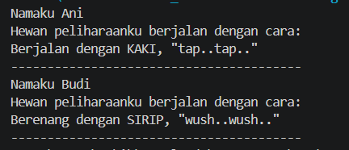
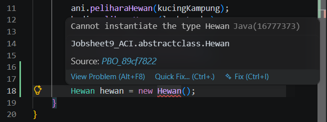
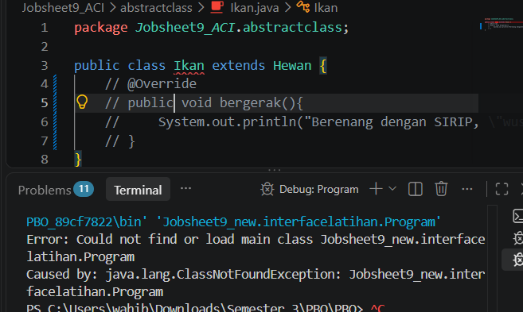
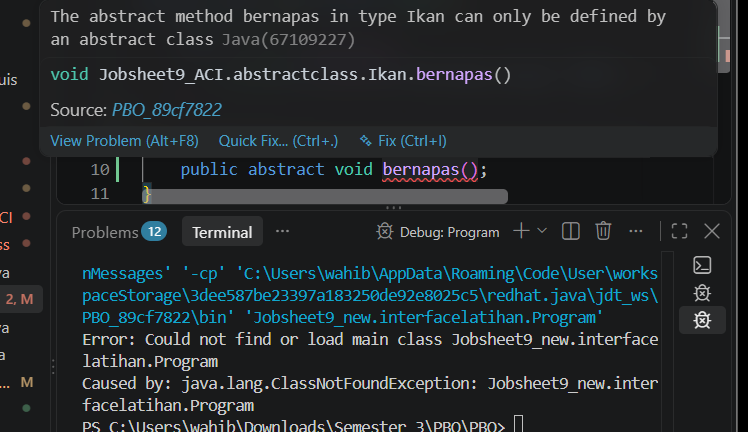
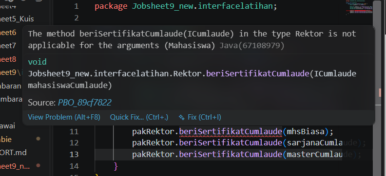
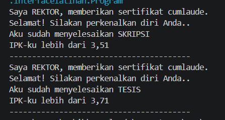

|  | Pemrograman Berbasis Objek |
|--|--|
| NIM |  254107020062|
| Nama | Aura Bintang Aprilian |
| Kelas | TI - 2G |
| Repository | [link] (https://github.com/bebeaura1/PBO/tree/main/Jobsheet9_ACI) |

# Abstract Class dan Interface

## - Percobaan 1: Abstract Class
Untuk hasil running program pada percobaan 1 yaitu seperti dibawah ini. 
 

**Jawaban Pertanyaan Percobaan 1**  
1. Program berjalan dengan membuat objek Kucing dan Ikan yang di masukkan ke dalam atribut hewanPeliharaan milik objek Orang melalui method peliharaHewan(). Ketika method ajakPeliharaanJalanJalan() dipanggil, Java menggunakan mekanisme polimorfisme dan Dynamic Method Dispatch. Pemanggilan this.hewanPeliharaan.bergerak() menghasilkan output yang berbeda karena variabel tersebut menunjuk pada tipe objek asli yang berbeda di memori saat runtime: Ani memelihara Kucing sehingga menjalankan versi bergerak() milik Kucing, sedangkan Budi memelihara Ikan sehingga menjalankan versi bergerak() milik Ikan. 
2. Hasil Error : Cannot instantiate the type Hewan 
 
Class Hewan dideklarasikan sebagai abstract class. Abstract class bersifat umum dan tidak dapat diinstansiasi secara langsung menggunakan kata kunci new. Ia hanya bisa diinisialisasi melalui objek dari subclass turunannya. 
3. Hasil Error : 
 
Setiap subclass biasa (konkret) yang menurunkan abstract class wajib meng-override dan mengisi semua abstract method yang ada di induknya. Jika tidak diisi, class tersebut harus ikut dicap sebagai class abstract. 
4. Hasil Error : Terjadi error kompilasi pada class Ikan karena gagal mengimplementasikan method abstract baru (bernapas()) yang diwariskan atau dideklarasikan. 
 
Aturan yang dilanggar adalah kewajiban subclass konkret untuk memenuhi semua kontrak abstract method dari induknya. Jika class Ikan ditambahkan method abstract baru di dalamnya atau di induknya tanpa di-override, maka Ikan melanggar aturan implementasi class non-abstract.  

## - Percobaan 2: Interface
Untuk hasil running program pada percobaan 2 yaitu seperti dibawah ini. 
- Sebelum diperbaiki : 
 
- Setelah diperbaiki : 
 