|  | Pemrograman Berbasis Objek |
|--|--|
| NIM |  254107020062|
| Nama | Aura Bintang Aprilian |
| Kelas | TI - 2G |
| Repository | [link] (https://github.com/bebeaura1/PBO/tree/main/Jobsheet9_ACI) |

# Abstract Class dan Interface

## - Percobaan 1: Abstract Class
Untuk hasil running program pada percobaan 1 yaitu seperti dibawah ini. 
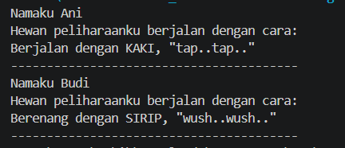 

**Jawaban Pertanyaan Percobaan 1**  
1. Program berjalan dengan membuat objek Kucing dan Ikan yang di masukkan ke dalam atribut hewanPeliharaan milik objek Orang melalui method peliharaHewan(). Ketika method ajakPeliharaanJalanJalan() dipanggil, Java menggunakan mekanisme polimorfisme dan Dynamic Method Dispatch. Pemanggilan this.hewanPeliharaan.bergerak() menghasilkan output yang berbeda karena variabel tersebut menunjuk pada tipe objek asli yang berbeda di memori saat runtime: Ani memelihara Kucing sehingga menjalankan versi bergerak() milik Kucing, sedangkan Budi memelihara Ikan sehingga menjalankan versi bergerak() milik Ikan. 
2. Hasil Error : Cannot instantiate the type Hewan 
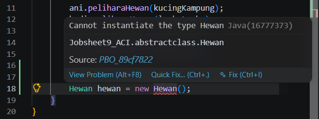 
Class Hewan dideklarasikan sebagai abstract class. Abstract class bersifat umum dan tidak dapat diinstansiasi secara langsung menggunakan kata kunci new. Ia hanya bisa diinisialisasi melalui objek dari subclass turunannya. 
3. Hasil Error : 
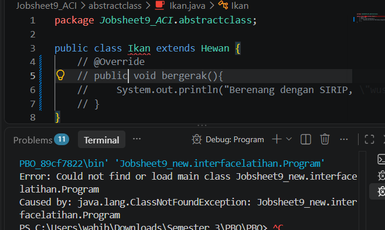 
Setiap subclass biasa (konkret) yang menurunkan abstract class wajib meng-override dan mengisi semua abstract method yang ada di induknya. Jika tidak diisi, class tersebut harus ikut dicap sebagai class abstract. 
4. Hasil Error : Terjadi error kompilasi pada class Ikan karena gagal mengimplementasikan method abstract baru (bernapas()) yang diwariskan atau dideklarasikan. 
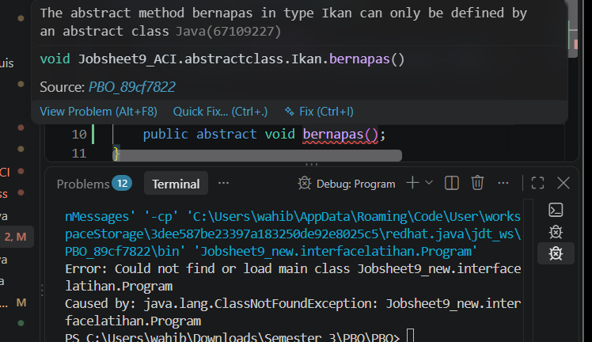 
Aturan yang dilanggar adalah kewajiban subclass konkret untuk memenuhi semua kontrak abstract method dari induknya. Jika class Ikan ditambahkan method abstract baru di dalamnya atau di induknya tanpa di-override, maka Ikan melanggar aturan implementasi class non-abstract.  

## - Percobaan 2: Interface
Untuk hasil running program pada percobaan 2 yaitu seperti dibawah ini. 
- Sebelum diperbaiki : 
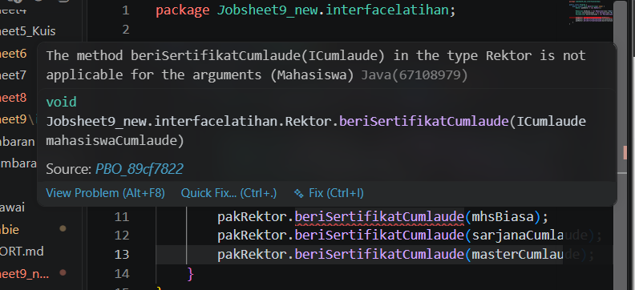 
- Setelah diperbaiki : 
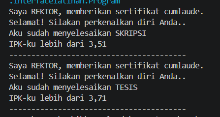 

**Jawaban Pertanyaan Percobaan 2**  
1. Pesan error : The method beriSertifikatCumlaude(ICumlaude) in the type Rektor is not applicable for the arguments (Mahasiswa). 
Error terjadi karena objek mhsBiasa (bertipe Mahasiswa) dikirimkan ke parameter beriSertifikatCumlaude(ICumlaude mahasiswaCumlaude) dimana class Mahasiswa tidak meng-implements interface ICumlaude. Cara memperbaikinya adalah dengan menghapus atau memberi komentar pada baris pemanggilan pakRektor.beriSertifikatCumlaude(mhsBiasa); di class Program karena mahasiswa biasa tidak berhak mendapat sertifikat cumlaude. 
2. Bisa. Karena class Sarjana merupakan turunan dari class Mahasiswa, sehingga secara otomatis class Sarjana mewarisi seluruh atribut dan method publik/protected yang dimiliki oleh class Mahasiswa, termasuk method kuliahDiKampus(). 
3. Tidak bisa secara langsung. Parameter mahasiswaCumlaude dideklarasikan bertipe interface ICumlaude. Di dalam interface ICumlaude, hanya terdapat kontrak method lulus() dan meraihIPKTinggi(). Compiler hanya mengenali anggota yang berasal dari tipe referensinya, dan interface ICumlaude tidak memiliki method kuliahDiKampus(). 
4. Hasil error : 
 
Semua method di dalam sebuah interface otomatis bersifat public. Ketika sebuah class mengimplementasikan interface tersebut, method hasil override pada class tidak boleh memperkecil hak aksesnya (harus tetap setara, yaitu public)  

## - Percobaan 3: Multiple Interface
Untuk hasil running program pada percobaan 3 yaitu seperti dibawah ini : 
- Sebelum diperbaiki : 
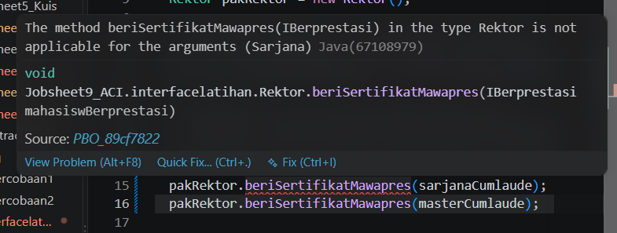 
- Setelah diperbaiki : 
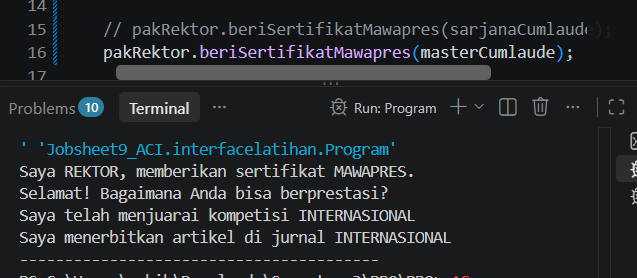 

**Jawaban Pertanyaan Percobaan 3**  
1. Hasil error : Cannot reduce the visibility of the inherited method from IBerprestasi 
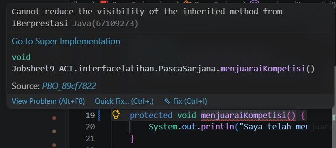 
Seluruh method didalam interface secara otomatis bersifat public. Interface dirancang sebagai kontrak terbuka untuk diakses dari luar, sehingga modifier akses selain public dilarang keras ditulis di dalam deklarasi method interface 
2. Baris tersebut error karena interface tidak memiliki constructor dan tidak dapat diinstansiasi secara langsung menggunakan kata kunci new. Objek hanya dapat dibuat melalui class yang mengimplementasikannya 
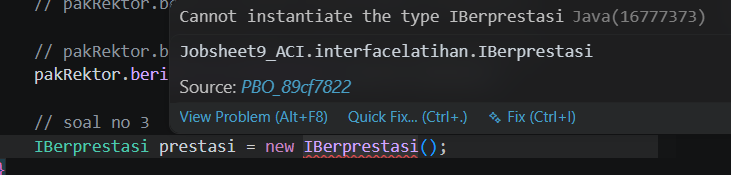 
3. - Kode : 
    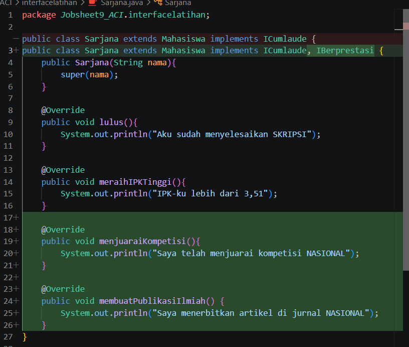
    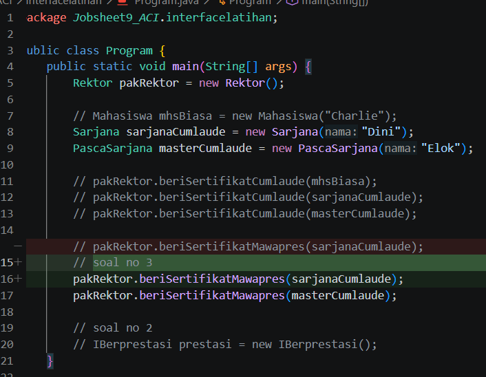 
    - Hasil : 
    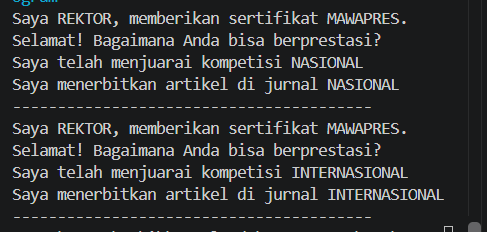  
    
## Tugas
1. 
    - Input : 
        - Class Binatang 
        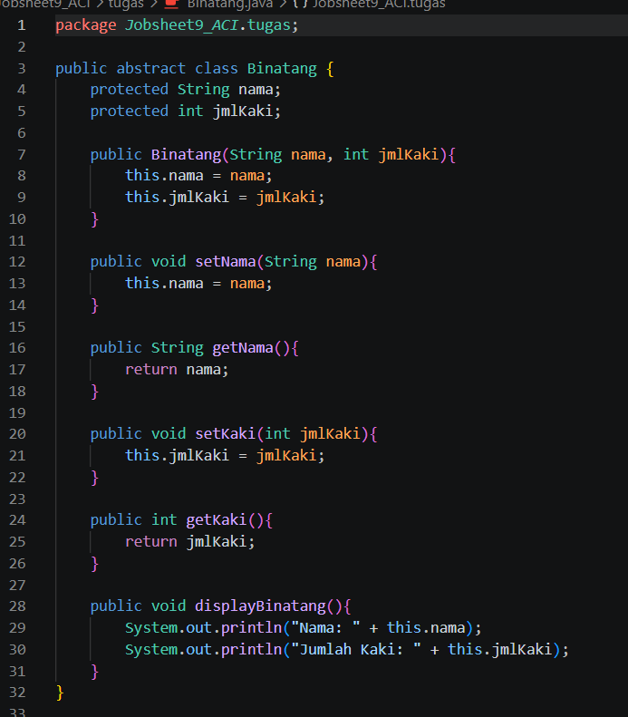 
        - Class IHerbivora 
        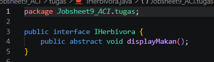 
        - Class IKarnivora 
        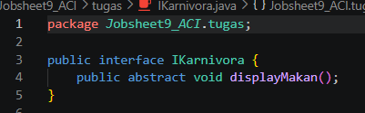 
        - Class Gorila 
        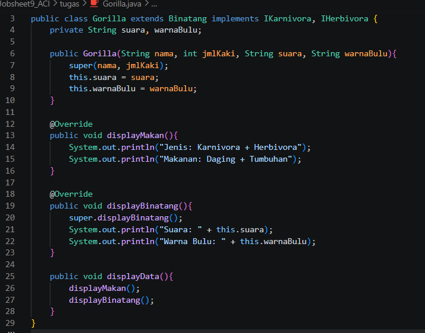 
        - Class Keledai 
        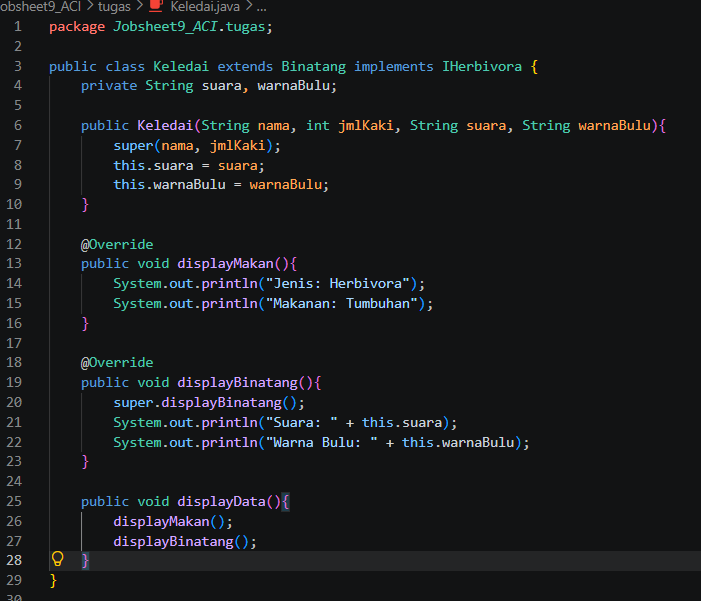 
        - Class Singa 
        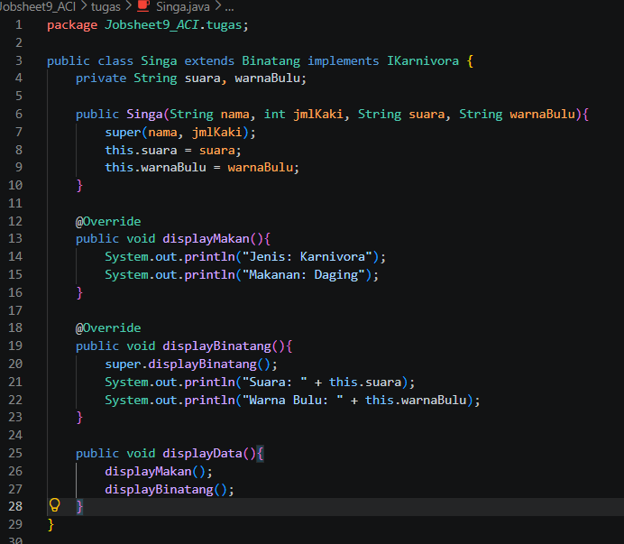 
        - Class MainTugas 
        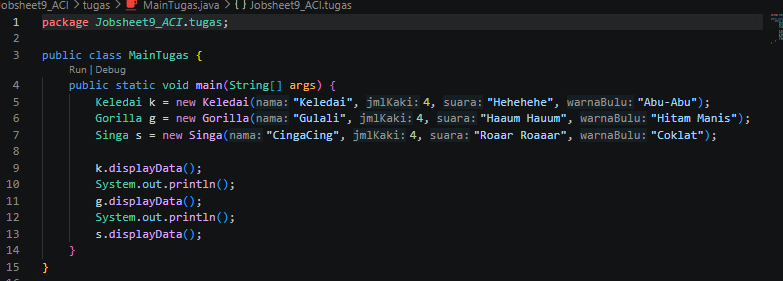 
    - Output : 
    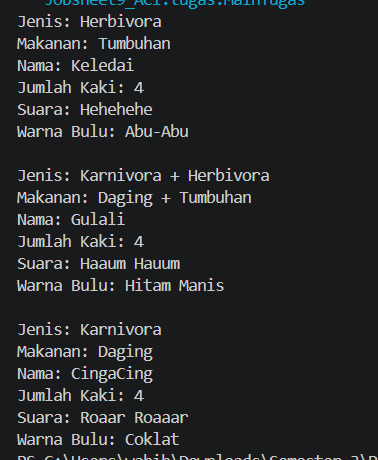  
    - UML : 
    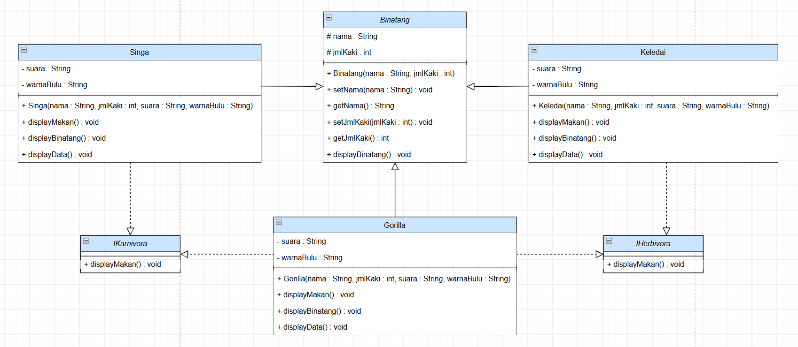