|  | Pemrograman Berbasis Objek |
|--|--|
| NIM |  254107020062|
| Nama | Aura Bintang Aprilian |
| Kelas | TI - 2G |
| Repository | [link] (https://github.com/bebeaura1/PBO/tree/main/Jobsheett10) |

# SOLID Principle dan Collections

## - Langkah 1: Proyek dan Kelas Dasar (Customer, Exception, Account)
Untuk hasil running program pada langkah 1 yaitu seperti dibawah ini. 
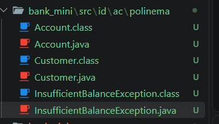 

## - Langkah 2: Subclass dan Interface (SavingsAccount, CheckingAccount)
Untuk hasil running program pada langkah 2 yaitu seperti dibawah ini. 
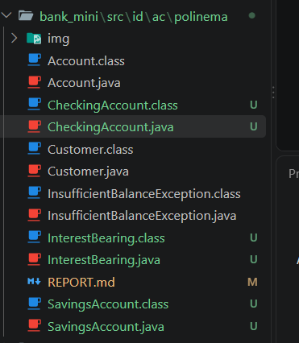 

## - Langkah 3: Bank Berbasis Array dan Program Utama
Untuk hasil running program pada langkah 3 yaitu seperti dibawah ini : 
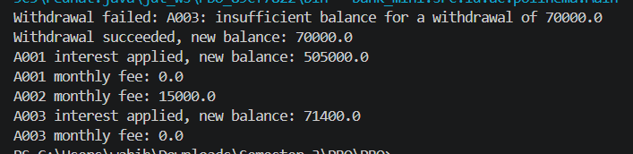 

## - Langkah 4: Bank Beralih dari Array ke Map
Untuk hasil running program pada langkah 4 yaitu seperti dibawah ini : 
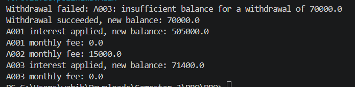 

## - Langkah 5:  Transaction, Single Responsibility Principle
Untuk hasil running program pada langkah 5 yaitu seperti dibawah ini : 
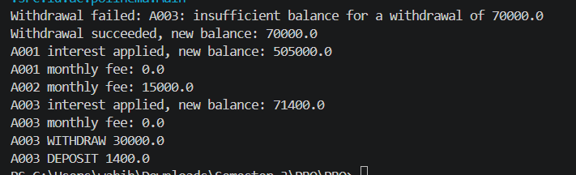 

## - Langkah 6:  AccountRepository, Dependency Inversion Principle
Untuk hasil running program pada langkah 6 yaitu seperti dibawah ini : 
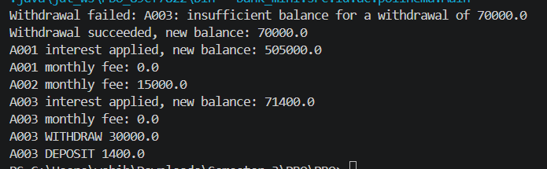 

## - Langkah 7: Menelusuri OCP, LSP, dan ISP pada Kode yang Sudah Dibangun
Untuk hasil running program pada langkah 7 yaitu seperti dibawah ini : 
    - 7a. Open/Closed 
    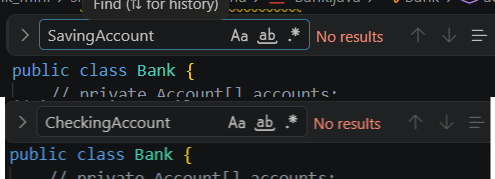 
    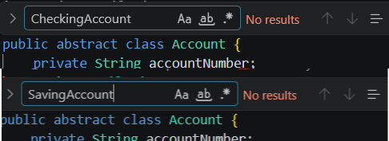 
    - 7b. Liskov Substitution 
    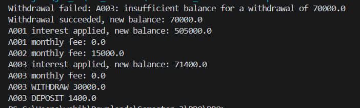 
    - 7c. Interface Segregation 
    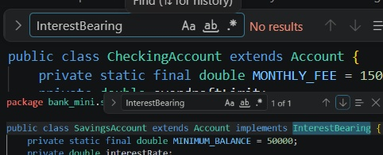 
    
## Tugas Mandiri
1. 
    - Input : 
        - Class BusinessAccount 
        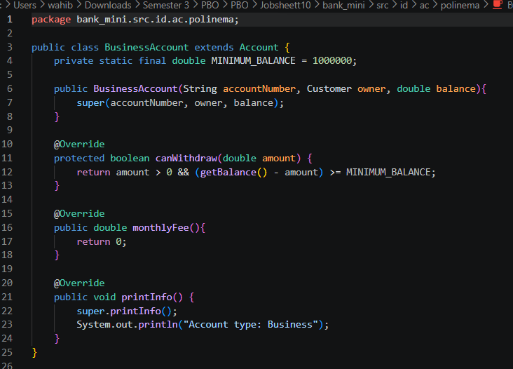 
        - Class Main 
        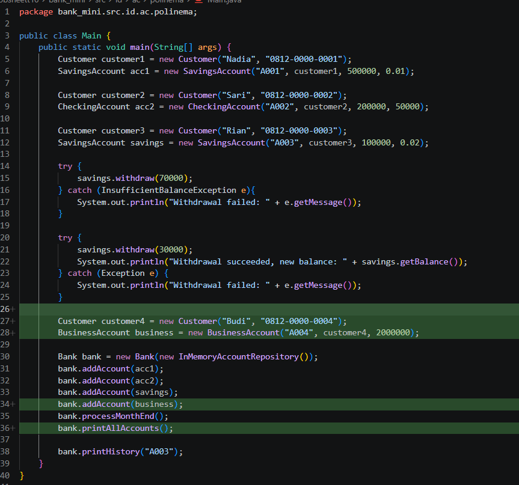 
    - Output : 
    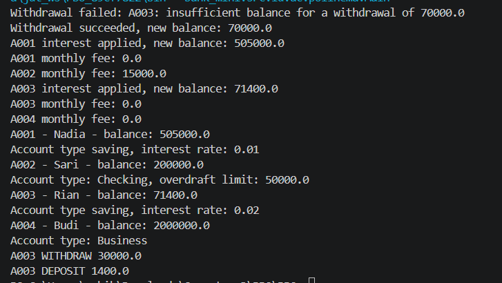  

2. - **(a)** Prinsip yang dibuktikan adalah Open/Closed Principle (OCP). Prinsip ini menyatakan bahwa sebuah entitas perangkat lunak harus terbuka untuk ekstensi (bisa ditambah fitur baru), tetapi tertutup untuk modifikasi (kode lama tidak boleh diubah). Fakta bahwa Account dan Bank tidak perlu diubah sama sekali saat kita menambahkan BusinessAccount membuktikan bahwa sistem sudah didesain dengan baik. Kita bisa memperluas fungsionalitas sistem hanya dengan membuat class turunan baru, tanpa harus mengotak-atik kode inti yang sudah berjalan. 
    - **(b)** Hal ini membuktikan penerapan ISP dan LSP. Method processMonthEnd() tidak perlu tau apakah sebuah objek itu SavingsAccount atau BusinessAccount. Bank hanya bertanya pada objek tersebut "apakah kamu memiliki kemampuan InterestBearing?". Karena BusinessAccount tidak mengimplements interface InterestBearing, maka secara otomatis Bank akan melewatinya (tidak memberikan bunga). Bank tidak perlu mengetahui detail class BusinessAccount karena Bank sepenuhnya bergantung pada interface bukan pada class konkret. 
    - **(c)** Prinsip yang membuat ini mungkin adalah DIP. Prinsip ini menyatakan bahwa modul tingkat tinggi (Bank) tidak boleh bergantung pada modul tingkat rendah ( InMemoryAccountRepository), melainkan harus bergantung pada interface AccountRepository. Bank tidak peduli datanya disimpan di memori, atau dimanapun. Selama class baru tersebut mengimplements interface AccountRepository, Bank bisa langsung menggunakannya tanpa perlu diubah kodenya sama sekali.